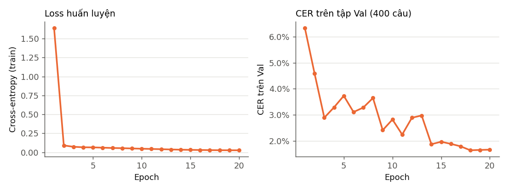
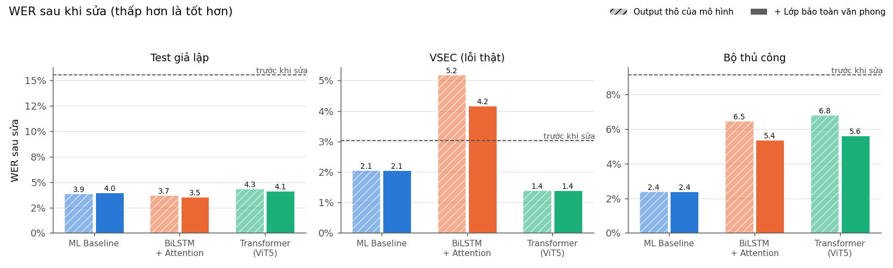
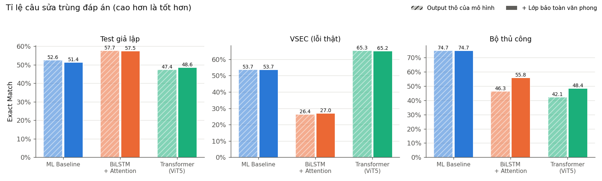
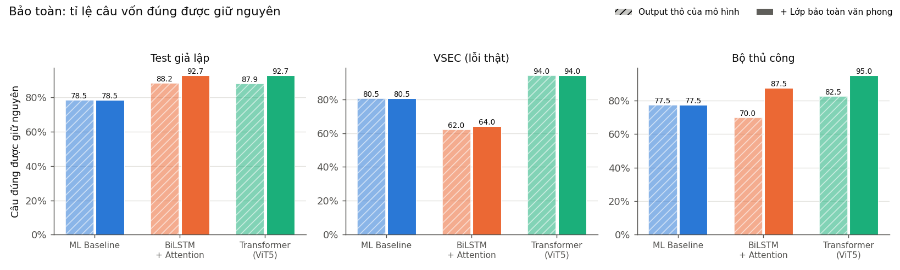
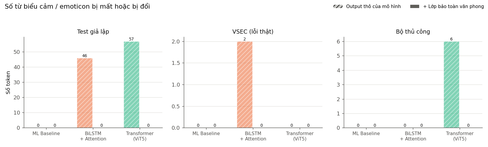
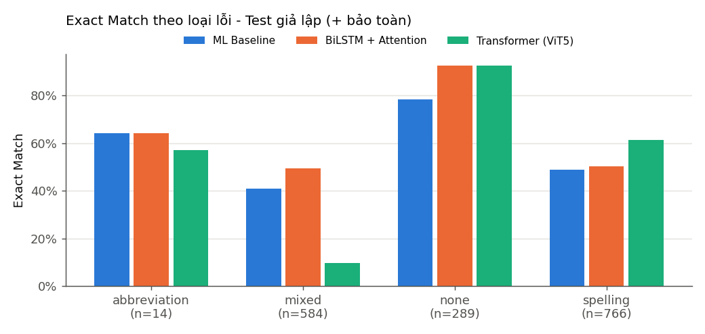
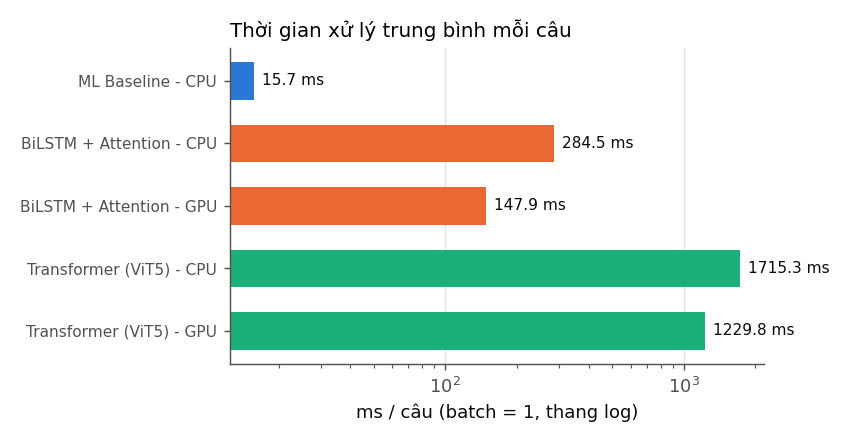

# Báo cáo đồ án: Hệ thống phát hiện và tự động sửa lỗi chính tả, ngữ pháp tiếng Việt có xét ngữ cảnh và bảo toàn văn phong gốc

> Mọi con số trong báo cáo được đo thực tế bằng các script trong thư mục `scripts/` và lưu trong
> `outputs/metrics/` (JSON/CSV) và `outputs/predictions/` (output từng câu). Môi trường đo: Windows 11,
> Python 3.10, PyTorch 2.5.1 + CUDA 12.1, GPU NVIDIA RTX 4050 Laptop 6 GB, CPU 8 luồng.

---

## 1. Giới thiệu

### 1.1. Lý do chọn đề tài

Văn bản tiếng Việt gõ trên máy tính, điện thoại thường có lỗi: gõ nhầm phím, quên hoặc sai dấu thanh
(do bộ gõ Telex/VNI), nhầm phụ âm theo phát âm vùng miền (s/x, ch/tr, d/gi/r), viết tắt kiểu
"teencode" và một số lỗi ngữ pháp đơn giản. Các công cụ sửa lỗi hiện có hoặc chỉ tra từ điển (không
xét ngữ cảnh), hoặc dùng mô hình sinh văn bản nên dễ **sửa quá mức** – viết lại câu, đổi văn phong
thân mật sang trang trọng, xoá các từ biểu cảm như "hihi", ":))".

### 1.2. Mục tiêu

1. Xây dựng và so sánh 3 hướng tiếp cận: ML cơ bản, Deep Learning (Seq2Seq BiLSTM + Attention) và
   Transformer đã huấn luyện sẵn.
2. Xây dựng cơ chế **hạn chế sửa quá mức, bảo toàn văn phong** dùng chung cho cả 3 mô hình.
3. Đánh giá trên cùng các tập kiểm thử với cùng cách tiền xử lý, có cả dữ liệu lỗi thật.
4. Có giao diện demo và báo cáo dựa trên kết quả thực tế.

### 1.3. Phạm vi

Lỗi chính tả/gõ phím; thiếu hoặc sai dấu; sai từ theo ngữ cảnh (dành/giành); lỗi ngữ pháp có quy tắc
rõ ràng (quan hệ từ thừa "nhưng nên", sai cặp "Vì… nhưng", lặp hư từ "của của"); viết hoa, dấu câu;
viết tắt phổ biến (e, ko, mik, dc…). Không nhằm sửa lỗi diễn đạt, lỗi logic hay viết lại câu.

---

## 2. Cơ sở lý thuyết (tóm tắt)

**Học máy cổ điển.** Biểu diễn văn bản bằng đặc trưng thủ công (TF-IDF n-gram ký tự, tần suất từ,
điểm mô hình ngôn ngữ) rồi dùng bộ phân loại tuyến tính như **Logistic Regression** để quyết định
một token có lỗi hay không. Việc chọn từ thay thế dựa vào **khoảng cách chỉnh sửa (edit distance)**
giữa chữ sai và các từ trong từ điển, cùng **mô hình ngôn ngữ n-gram** (xác suất một từ đi sau từ
trước) để chọn phương án hợp ngữ cảnh nhất.

**Seq2Seq.** Bài toán sửa lỗi được xem như "dịch" từ câu lỗi sang câu đúng. **Encoder** (ở đây là
BiLSTM – LSTM hai chiều) đọc toàn bộ câu nguồn thành chuỗi vector; **Decoder** (LSTM) sinh câu đích
từng ký tự một.

**Attention.** Thay vì nén cả câu vào một vector, tại mỗi bước sinh, decoder "nhìn lại" tất cả vị trí
của encoder và tính trọng số chú ý – rất hợp với sửa lỗi vì phần lớn ký tự đầu ra là sao chép ký tự
đầu vào ở vị trí tương ứng.

**Transformer.** Kiến trúc chỉ dùng cơ chế self-attention (không có hồi quy), huấn luyện song song
được trên dữ liệu rất lớn. Các mô hình encoder–decoder như T5/BART được tiền huấn luyện trên văn bản
lớn rồi **fine-tune** cho sửa lỗi. Đồ án dùng **ViT5** (T5 tiếng Việt) đã được fine-tune sẵn.

---

## 3. Dữ liệu

### 3.1. Nguồn

| Nguồn | Dùng cho | Giấy phép | Ghi chú |
|---|---|---|---|
| [nrl-ai/vn-spell-correction-train](https://huggingface.co/datasets/nrl-ai/vn-spell-correction-train) – chỉ lấy phía `target` (câu sạch) | Câu sạch để tự sinh lỗi; từ điển và n-gram LM | CC-BY-SA-4.0 | Wikipedia tiếng Việt + tin tức. Câu train lấy từ `train.jsonl`, câu Val/Test lấy từ `val.jsonl` |
| [VSEC](https://arxiv.org/abs/2111.00640) (bản HF `nguyenthanhasia/vsec-vietnamese-spell-correction`) | **Chỉ để kiểm thử** – lỗi chính tả do người gõ thật | CC-BY-NC-ND-4.0 (gốc) | 9.341 câu báo chí; không sửa đổi hay phân phối lại |
| Bộ câu thủ công `data/test_real.jsonl` | **Chỉ để kiểm thử** | – | 95 câu do người làm đồ án tự soạn (xem 3.5) |

Không tìm thấy dataset sửa *ngữ pháp* tiếng Việt có giấy phép rõ ràng, quy mô phù hợp, nên lỗi ngữ
pháp được sinh bằng quy tắc.

### 3.2. Lọc câu sạch (`src/prepare_data.py`)

Giữ câu 5–30 âm tiết, ≤160 ký tự, viết hoa đầu câu và kết thúc bằng `.!?`, không chứa ký hiệu
wiki (`=`, `|`, `{}`…), ít nhất 40% từ có dấu tiếng Việt (loại câu tiếng nước ngoài), không quá
nhiều tên riêng. Khử trùng lặp bằng khoá chuẩn hoá (chữ thường, bỏ dấu, bỏ dấu câu).

Kết quả: **208.996** câu hợp lệ từ 459.478 dòng train; **2.270** câu hợp lệ từ 5.000 dòng val.

### 3.3. Sinh lỗi có kiểm soát (`src/generate_noise.py`)

| Loại lỗi | Cách sinh | Ví dụ |
|---|---|---|
| `diacritic` | bỏ toàn bộ dấu / đổi dấu thanh / bỏ dấu mũ-móc | học → hoc, hỏi → hói |
| `typo` | đảo, thiếu, thừa ký tự, gõ nhầm phím bên cạnh (QWERTY) | học → hco |
| `phonetic` | nhầm s/x, ch/tr, d/gi/r, l/n, c/t, n/ng, nh/n | giành → dành, xuất → suất |
| `abbreviation` | thay bằng dạng viết tắt | không → ko, được → dc, mình → mik |
| `grammar` | thêm "nên" sau "nhưng"; "Vì… nên" → "Vì… nhưng"; lặp hư từ | nhưng tôi → nhưng nên tôi |
| `casing` / `punctuation` | hạ chữ hoa đầu câu (25%), bỏ dấu câu cuối (20%) | |

Mỗi câu nhận 1–3 lỗi âm tiết (xác suất 50/33/17%); 12% câu bị bỏ dấu toàn bộ (kiểu "hom nay e di
hoc"); 12% câu thử chèn lỗi ngữ pháp. Câu hội thoại có xác suất viết tắt cao hơn.

Ngoài câu wiki/báo (văn phong trang trọng), dữ liệu có thêm 3.000 **câu hội thoại sinh từ mẫu**
(ví dụ "Tối nay em đi xem phim có vui không? hihi") để mô hình thấy văn phong thân mật kèm từ cảm
thán/emoticon. Các câu gốc được chia tập **trước** khi gắn từ cảm thán, để biến thể của cùng một câu
không vượt ranh giới tập.

Định dạng một bản ghi:

```json
{"id": "test-4", "input": "Sáng mai a khong đi bơi đượ, vui quá.",
 "target": "Sáng mai anh không đi bơi được, vui quá.",
 "error_type": "mixed", "error_types": ["typo", "abbreviation", "diacritic"],
 "style": "informal", "source": "synthetic"}
```

### 3.4. Chia tập và chống rò rỉ

| Tập | Số câu | Câu đúng (input = target) | Nguồn câu sạch |
|---|---:|---:|---|
| Train | 152.400 | 30.573 (20,1%) | 150.000 câu `nrl_train` + 2.400 câu hội thoại |
| Val | 800 | 160 | 500 câu `nrl_val` + 300 câu hội thoại |
| Test giả lập | 1.653 | 289 | 1.353 câu `nrl_val` + 300 câu hội thoại |
| Test VSEC | 1.000 | 200 | 800 câu lỗi thật + 200 câu đã sửa đúng (khác câu) |
| Test thủ công | 95 | 40 | tự soạn |

Biện pháp chống rò rỉ: (1) câu Val/Test lấy từ file khác hẳn câu Train; (2) loại câu held-out trùng
khoá chuẩn hoá với câu Train; (3) loại câu held-out chia sẻ ≥50% 5-gram với câu Train (2.270 → 1.853
câu). Kiểm tra tự động (`tests/test_pipeline.py`) xác nhận **0 câu** trùng khoá giữa Train và
Val/Test. Từ điển và n-gram LM chỉ xây từ câu phía Train (208.996 câu + 2.400 câu hội thoại train).

### 3.5. Bộ kiểm thử thủ công (95 câu)

| Nhóm | Số câu | Nội dung |
|---|---:|---|
| `formal_error` | 21 | câu trang trọng có lỗi gõ, dấu, từ sai ngữ cảnh (suất sắc, mở của, mai sao…) |
| `formal_correct` | 20 | câu trang trọng hoàn toàn đúng |
| `grammar` | 8 | "nhưng nên", "Vì… nhưng", "các các", "đã đã" |
| `chat_error` | 10 | hội thoại có lỗi (kèm hihi, :)), huhu) |
| `chat_correct` | 20 | hội thoại đúng, có từ láy ("từ từ", "ngày ngày"), cảm thán, emoji |
| `teencode` | 16 | viết tắt: ko, mik, dc, bh, vs, j, tks, mn… |

Quy ước đáp án: chỉ sửa lỗi; viết hoa đầu câu; câu hỏi rõ ràng được thêm "?"; **câu hội thoại không
bắt buộc thêm dấu chấm cuối** (giữ văn phong); không đổi từ ngữ, xưng hô, cảm thán.

> **Hạn chế quan trọng:** bộ này do chính người làm đồ án soạn, *cùng người* đã viết bảng viết tắt và
> quy tắc ngữ pháp của ML Baseline. Vì vậy kết quả của ML trên bộ này **bị thiên lệch có lợi** và
> chỉ nên xem là minh hoạ định tính, không phải thước đo chất lượng thực tế. 95 câu cũng là quá ít
> để kết luận thống kê.

---

## 4. Phương pháp

### 4.1. Mô hình 1 – ML Baseline (`src/baseline_ml.py`)

1. **Từ điển + bigram LM:** 34.183 âm tiết (tần suất ≥2), 269.030 bigram (tần suất ≥2), làm trơn
   *absolute discounting* nội suy với unigram.
2. **Phát hiện lỗi cấp token:** Logistic Regression trên
   - TF-IDF n-gram ký tự (1–3) của token,
   - đặc trưng số: có trong từ điển, log tần suất, là viết tắt, có dấu, độ dài, điểm LM của token với
     hai từ lân cận, *mức tăng điểm LM tốt nhất nếu thay bằng một ứng viên*, số ứng viên.
   Huấn luyện trên 400.003 token đầu của tập Train (14,4% là lỗi; nhãn có được bằng căn chỉnh
   input–target).
3. **Sinh ứng viên** cho token bị nghi lỗi: biến thể dấu cùng dạng không dấu, edit distance 1 trên
   dạng không dấu, nhầm phụ âm đầu/cuối, bảng viết tắt (có thể mở rộng thành nhiều từ: bh → bây giờ).
   Mỗi loại có một "chi phí kênh".
4. **Chọn ứng viên bằng beam search** (beam 8) tối đa hoá *điểm LM − w × chi phí kênh*.
5. **Quy tắc:** xoá hư từ lặp, xoá quan hệ từ thừa, "Vì… nhưng" → "Vì… nên", viết hoa đầu câu,
   truecasing tên riêng phổ biến (Việt, Nam, Hà, Nội…), thêm "?" / "." cuối câu theo heuristic.

Ngưỡng phát hiện và trọng số w được chọn trên 400 câu Val theo WER: **ngưỡng 0,45, w = 3,0**
(lưới 3×3, `outputs/metrics/ml_training.json`). Thời gian huấn luyện ≈ 4,7 phút trên CPU.

### 4.2. Mô hình 2 – BiLSTM + Attention (`src/bilstm_attention.py`)

- **Cấp ký tự** (1.188 ký tự trong từ vựng) – không gặp vấn đề từ ngoài từ điển với chữ gõ sai.
- Encoder: Embedding 128 → BiLSTM 2 lớp, 256 chiều mỗi hướng. Trạng thái cuối được chiếu thành
  trạng thái đầu của decoder.
- Decoder: LSTM 1 lớp 512 chiều + **Luong attention ("general")**, lớp kết hợp `tanh`, softmax ra
  ký tự. Tổng **5,91 triệu tham số**.
- Huấn luyện: teacher forcing, cross-entropy, AdamW + OneCycle (lr 2e-3), batch 128, mixed precision,
  20 epoch trên 152.400 cặp (≈85 giây/epoch trên RTX 4050). Giữ checkpoint có CER Val thấp nhất
  (**epoch 18**: CER Val 1,64%, WER Val 4,13%).
- Suy luận: greedy decoding theo lô; câu dài được cắt theo câu/từ (≤170 ký tự).



### 4.3. Mô hình 3 – Pre-trained Transformer (`src/pretrained_model.py`)

Hai checkpoint đã fine-tune cho sửa lỗi tiếng Việt được kiểm tra (đều Apache-2.0, tải và chạy
local, không cần API key):

| Checkpoint | Kiến trúc | Tham số | Val (300) WER / EM / giữ câu đúng | VSEC (200) WER / EM | Thủ công WER / EM |
|---|---|---:|---|---|---|
| `bmd1905/vietnamese-correction-v2` | BARTpho-syllable (MBart) | ~396M | 13,5% / 31,3% / 65,1% | 2,91% / 27,5% | 9,62% / 37,9% |
| **`nrl-ai/vn-spell-correction-base`** | ViT5-base (T5) | 226M | **5,79% / 41,7% / 84,1%** | **1,17% / 66,5%** | **6,81% / 42,1%** |

(`scripts/select_transformer.py`, `outputs/metrics/transformer_selection.json`.) Chọn
**nrl-ai/vn-spell-correction-base**: tốt hơn trên cả 3 tập và nhẹ hơn. Lưu ý trung thực: thí nghiệm
chọn mô hình có dùng 200 câu VSEC đầu và bộ thủ công (là dữ liệu test); tuy nhiên chênh lệch trên
riêng tập Val đã đủ rõ (WER 5,79% so với 13,5%) để đưa ra cùng quyết định.

Checkpoint này được nhóm tác giả fine-tune trên phía `train` của chính bộ nrl-ai; câu Test giả lập
của đồ án lấy từ phía `val` nên không nằm trong dữ liệu huấn luyện của nó (theo cách chia của tác
giả). Không fine-tune thêm vì mô hình đã được huấn luyện trên 459K cặp cùng miền – lợi ích không rõ
so với chi phí. Chạy GPU (fp16) hoặc CPU (fp32), greedy decoding.

### 4.4. Lớp hạn chế sửa quá mức và bảo toàn văn phong (`src/preservation.py`)

Áp dụng **sau** bất kỳ mô hình nào:

1. Tách token (giữ nguyên emoticon như `:))`, `:D`, `^^`), **căn chỉnh** câu gốc và câu mô hình sinh
   ra theo khoá không dấu – chữ thường; tách thành từng phép sửa nhỏ (thay, thêm, xoá). Dấu câu ở
   biên và các cụm viết tắt nhiều từ (bh → bây giờ) được tách thành phép sửa riêng.
2. Phân loại phép sửa: viết hoa, dấu câu, viết tắt, dấu thanh, nhầm phụ âm, ngữ pháp, tách/ghép từ,
   lỗi gõ, thêm từ, xoá từ.
3. **Xét riêng từng phép sửa:**
   - Không sửa/xoá token biểu cảm (hihi, haha, huhu, nha, nhé, ạ, ơi, ừ, emoticon, emoji, URL).
   - Tắt "chuẩn hoá viết tắt" → giữ nguyên ko, mik, dc…
   - Không hạ chữ hoa của câu gốc.
   - Không thêm từ mới; không xoá từ, trừ lặp hư từ và quan hệ từ thừa có quy tắc.
   - Từ gốc là **từ hợp lệ** → chỉ chấp nhận thay đổi gần (dấu, nhầm phụ âm, 1–2 ký tự), và khi
     thay từ hợp lệ bằng từ hợp lệ khác thì **bigram LM phải cho điểm ngữ cảnh cao hơn** (kiểm tra độ
     tin cậy).
   - Từ gốc **không có trong từ điển** (lỗi gõ) → chấp nhận nếu phương án sửa đủ gần chữ gốc.
4. Phép sửa bị từ chối được **hoàn tác và hiển thị thành gợi ý**.

Vì mỗi phép sửa được xét độc lập, câu có nhiều lỗi vẫn được sửa đủ (ví dụ câu không dấu 8 lỗi
"Kinh tế viet nam dang phat trien…" – có kiểm thử tự động). Ngưỡng LM được chọn trên Val
(`scripts/tune_preservation.py`):

| Transformer trên Val (800 câu) | WER sau sửa | Exact Match | Giữ câu đúng | Biểu cảm bị mất |
|---|---:|---:|---:|---:|
| Output thô | 5,33% | 42,5% | 85,0% | 53 |
| + bảo toàn, không kiểm tra LM | 4,82% | 45,5% | 93,1% | 0 |
| + bảo toàn + kiểm tra LM (margin 0, được chọn) | **4,70%** | **46,8%** | **95,6%** | **0** |
| + bảo toàn + kiểm tra LM (margin 5) | 4,77% | 46,6% | 95,6% | 0 |

---

## 5. Triển khai

- **Ngôn ngữ, thư viện:** Python 3.10; scikit-learn 1.7 (TF-IDF, Logistic Regression); PyTorch 2.5.1
  (BiLSTM); Hugging Face Transformers 4.46 (ViT5); RapidFuzz (edit distance); Matplotlib (biểu đồ);
  Gradio 6 (demo); pytest.
- **Hướng dẫn chạy:** xem [README.md](README.md) – các bước tải dữ liệu, chuẩn bị dữ liệu, huấn luyện,
  đánh giá, vẽ biểu đồ, kiểm thử, chạy demo, và CLI `src/inference.py`.
- **Demo (`app.py`):** nhập văn bản; chọn mô hình ML / BiLSTM / Transformer; nút "Kiểm tra và sửa lỗi";
  hiển thị câu gốc và câu đã sửa; tô màu vị trí thay đổi (đỏ: gốc, xanh: sửa); bảng chi tiết từng
  thay đổi với loại lỗi, giải thích, trạng thái "Đã sửa" hoặc "Chỉ gợi ý – lý do"; tuỳ chọn bật/tắt
  chuẩn hoá viết tắt; bảo toàn văn phong bật mặc định; xem output thô của mô hình.
  Đã kiểm thử thủ công trong trình duyệt: chọn ML, nhập "hôm nay e đi hoc có vui không, hihi" →
  "Hôm nay em đi học có vui không, hihi" với 3 thay đổi (viết hoa, viết tắt, dấu); tắt chuẩn hoá viết
  tắt với "ko bít nữa, để mik hỏi lại đã :))" → giữ nguyên câu, 3 viết tắt hiện thành gợi ý.
- **Kiểm thử tự động:** `python -m pytest tests -q` với `RUN_TRANSFORMER=1` → **13/13 passed**
  (tiện ích văn bản, sinh lỗi, chống rò rỉ, chỉ số, các quy tắc bảo toàn, 3 mô hình, API suy luận).

---

## 6. Kết quả thực nghiệm

### 6.1. Cách đánh giá

Cả 3 mô hình chạy trên cùng 3 tập Test; mọi chuỗi được đưa về cùng một dạng trước khi chấm (chuẩn
hoá Unicode NFC, tách dấu câu thành token riêng, 1 khoảng trắng). Mỗi mô hình được chấm 2 lần: output
**thô** và output **+ lớp bảo toàn**.

- **Phát hiện lỗi cấp câu:** câu có lỗi (input ≠ target) so với câu bị mô hình thay đổi.
- **Phát hiện lỗi cấp token** (báo cáo riêng): token nguồn có lỗi so với token nguồn bị mô hình thay
  đổi. Lỗi kiểu "thiếu token" (thiếu dấu chấm cuối câu) không có token nguồn nên không tính ở cấp
  này.
- **Sửa lỗi:** CER, WER (trước và sau sửa), Exact Match, F0.5 cấp phép sửa (một phép sửa đúng khi
  trùng cả vị trí và nội dung với đáp án – một bản đơn giản hoá của ERRANT; không triển khai M²).
- **Bảo toàn:** tỉ lệ câu vốn đúng được giữ nguyên; số câu đúng bị sửa thừa; số token biểu cảm
  (hihi, :)), ^^, emoji…) bị mất hoặc bị đổi.
- **Hiệu năng:** thời gian mỗi câu khi xử lý từng câu một (batch = 1, gồm cả lớp bảo toàn), thời gian
  khi xử lý theo lô, và kích thước mô hình.

Chưa thực hiện: GLEU, M², kiểm định ý nghĩa thống kê.

### 6.2. Bảng kết quả chính – Test giả lập (1.653 câu, + lớp bảo toàn)

Trước khi sửa: CER 4,77%, WER 15,51%, Exact Match 17,5%.

| Mô hình | Precision (câu) | Recall (câu) | F1 (câu) | CER sau sửa | WER sau sửa | Exact Match | Latency GPU / CPU (ms/câu, batch 1) |
|---|---:|---:|---:|---:|---:|---:|---|
| ML Baseline | 95,5% | 97,0% | 96,3% | 1,43% | 3,99% | 51,4% | – / **15,7** |
| BiLSTM + Attention | 98,4% | 93,8% | 96,0% | **1,10%** | **3,54%** | **57,5%** | 147,9 / 284,5 |
| Pre-trained Transformer | **98,4%** | 94,4% | **96,3%** | 1,60% | 4,10% | 48,6% | 1229,8 / 1715,3 |

Phát hiện lỗi cấp token và F0.5 (cùng tập, + bảo toàn):

| Mô hình | Precision (token) | Recall (token) | F1 (token) | F0.5 (phép sửa) | Giữ câu đúng (289 câu) | Câu đúng bị sửa thừa | Biểu cảm bị mất |
|---|---:|---:|---:|---:|---:|---:|---:|
| ML Baseline | 92,6% | 90,8% | 91,7% | 71,2% | 78,5% | 62 | 0 |
| BiLSTM + Attention | 96,6% | 87,9% | 92,0% | **77,0%** | **92,7%** | **21** | 0 |
| Pre-trained Transformer | **97,2%** | 85,3% | 90,9% | 73,5% | **92,7%** | **21** | 0 |

### 6.3. Test VSEC – lỗi do người gõ thật (1.000 câu, + lớp bảo toàn)

Trước khi sửa: CER 0,91%, WER 3,04%, Exact Match 20,0%.

| Mô hình | Precision (câu) | Recall (câu) | F1 (câu) | F1 (token) | F0.5 | CER sau | WER sau | Exact Match | Giữ câu đúng (200) |
|---|---:|---:|---:|---:|---:|---:|---:|---:|---:|
| ML Baseline | 94,2% | **79,1%** | 86,0% | 69,4% | 61,2% | 0,75% | 2,05% | 53,7% | 80,5% |
| BiLSTM + Attention | 87,1% | 61,0% | 71,8% | 40,9% | 33,0% | 1,43% | **4,18% (tệ hơn đầu vào)** | 27,0% | 64,0% |
| Pre-trained Transformer | **98,1%** | 76,6% | **86,0%** | **77,1%** | **76,3%** | **0,57%** | **1,39%** | **65,2%** | **94,0%** |

### 6.4. Bộ thủ công (95 câu, + lớp bảo toàn) – chỉ mang tính minh hoạ, xem hạn chế ở mục 3.5

Trước khi sửa: CER 4,79%, WER 9,11%, Exact Match 42,1% (40 câu vốn đúng).

| Mô hình | F1 (câu) | F1 (token) | CER sau | WER sau | Exact Match | Giữ câu đúng (40) | Biểu cảm bị mất |
|---|---:|---:|---:|---:|---:|---:|---:|
| ML Baseline | **87,7%** | **87,0%** | **0,77%** | **2,39%** | **74,7%** | 77,5% | 0 |
| BiLSTM + Attention | 83,5% | 85,4% | 2,51% | 5,37% | 55,8% | 87,5% | 0 |
| Pre-trained Transformer | 69,0% | 68,4% | 2,88% | 5,62% | 48,4% | **95,0%** | 0 |

Số câu sửa trùng đáp án theo nhóm (thô → + bảo toàn):

| Nhóm | ML Baseline | BiLSTM | Transformer |
|---|---|---|---|
| formal_error (21) | 15 → 15 | 8 → 8 | 5 → 5 |
| formal_correct (20) | 19 → 19 | 19 → 20 | 20 → 20 |
| grammar (8) | 7 → 7 | 5 → 5 | 0 → 0 |
| chat_error (10) | 7 → 7 | 2 → 3 | 0 → 1 |
| chat_correct (20) | 12 → 12 | 9 → 15 | 13 → 18 |
| teencode (16) | 11 → 11 | 1 → 2 | 2 → 2 |

### 6.5. Tác dụng của lớp bảo toàn văn phong (thô → + bảo toàn)

| Tập | Mô hình | WER sau sửa | Exact Match | Giữ câu đúng | Biểu cảm bị mất |
|---|---|---|---|---|---|
| Test giả lập | ML | 3,87% → 3,99% | 52,6% → 51,4% | 78,5% → 78,5% | 0 → 0 |
| Test giả lập | BiLSTM | 3,71% → 3,54% | 57,7% → 57,5% | 88,2% → 92,7% | 46 → 0 |
| Test giả lập | Transformer | 4,34% → 4,10% | 47,4% → 48,6% | 87,9% → 92,7% | 57 → 0 |
| VSEC | BiLSTM | 5,18% → 4,18% | 26,4% → 27,0% | 62,0% → 64,0% | 2 → 0 |
| VSEC | Transformer | 1,39% → 1,39% | 65,3% → 65,2% | 94,0% → 94,0% | 0 → 0 |
| Thủ công | BiLSTM | 6,47% → 5,37% | 46,3% → 55,8% | 70,0% → 87,5% | 0 → 0 |
| Thủ công | Transformer | 6,81% → 5,62% | 42,1% → 48,4% | 82,5% → 95,0% | 6 → 0 |







### 6.6. Hiệu năng và kích thước

| Mô hình | Kích thước | Tham số | ms/câu batch 1 (GPU / CPU) | ms/câu theo lô trên Test giả lập |
|---|---:|---:|---|---:|
| ML Baseline | 7,6 MB | – (14.205 trọng số LR, 34.183 âm tiết, 269.030 bigram) | – / 15,7 | 13,8 (CPU, tuần tự) |
| BiLSTM + Attention | 23,7 MB | 5,91 M | 147,9 / 284,5 | 2,6 (GPU, lô 64) |
| Pre-trained Transformer | 903,8 MB | 226,0 M | 1229,8 / 1715,3 | 112,2 (GPU, lô 16) |

Đo trên 100 câu Test (GPU) và 30 câu (CPU), có khởi động trước. Số đo dao động giữa các lần chạy
(một lần đo trước đó cho Transformer GPU là 1004 ms/câu); thứ tự giữa các mô hình không đổi. Với
batch 1, Transformer trên GPU laptop chỉ nhanh hơn CPU một chút vì chi phí mỗi bước sinh token
(~23 ms/bước) chiếm phần lớn; xử lý theo lô nhanh hơn khoảng 9–11 lần.



### 6.7. Ví dụ định tính (bộ thủ công, + bảo toàn)

| Câu gốc | ML Baseline | BiLSTM | Transformer |
|---|---|---|---|
| Hôm nay tôi đi hco ở trường. | …đi **học**… ✓ | …đi **cho**… ✗ | …đi **chợ**… ✗ |
| Đội tuyển Việt Nam đã dành chiến thắng… | không sửa ✗ | không sửa ✗ | không sửa ✗ |
| Tuy trời mưa nhưng nên tôi vẫn đi học. | xoá "nên" ✓ | xoá "nên" ✓ | không sửa ✗ |
| Kinh tế viet nam dang phat trien… | …**Việt nam đang phát triển**… (gần đúng) | …**viết nam**… ✗ | …**việt nam đang phát triển**… (thiếu viết hoa) |
| hôm nay e đi hoc có vui không, hihi | Hôm nay em đi học có vui không, hihi | giống ML | hôm nay em đi học có vui không, hihi |
| Cảm ơn bạn nhiều nha, … món quà này ^^ | giữ nguyên ✓ | thô: "nha → nhà" → **được khôi phục** ✓ | thô: "nha → nhà", xoá "^^" → **được khôi phục** ✓ |
| Bạn ăn cơm chưa? Mình đói bụng quá rồi hihi | giữ nguyên ✓ | giữ nguyên ✓ | thô: "hihi → khi" → **được khôi phục** ✓ |
| Ừ, để tớ xem lại đã nhé. | "đã → đá" ✗ | thô "Ừ → Ở" → khôi phục ✓ | thô "Ừ → Vậy" → khôi phục ✓ |
| bh mik đang bận, tí nữa gọi lại nhé | Bây giờ mình…, "tí → tỉ" ✗ | "bh → Bhi" ✗ | thô "bh → bạn" bị chặn → gợi ý; "mik → mình" ✓ |
| Mọi người nên dành thời gian cho gia đình… (câu đúng) | giữ nguyên ✓ | giữ nguyên ✓ | giữ nguyên ✓ |

Câu đầu ra mong muốn ở đề bài "Hôm nay em đi học có vui không? Hihi" chưa mô hình nào đạt trọn vẹn:
cả 3 không đổi dấu phẩy thành dấu hỏi trước từ cảm thán.

---

## 7. Phân tích

### 7.1. Mô hình nào tốt hơn?

Không có mô hình thắng tuyệt đối; kết quả phụ thuộc mạnh vào loại dữ liệu:

- **Trên lỗi thật (VSEC), Transformer tốt nhất rõ rệt:** WER 3,04% → 1,39%, Exact Match 65,2%, giữ
  nguyên 94% câu đúng, F0.5 76,3%. Đây là tập đáng tin cậy nhất để nói về chất lượng thực tế (lỗi do
  người, không do script của đồ án sinh ra). ML đứng thứ hai (WER 2,05%), còn **BiLSTM làm văn bản tệ
  hơn đầu vào** (WER 4,18%).
- **Trên Test giả lập, BiLSTM tốt nhất** (WER 3,54%, Exact Match 57,5%, F0.5 77,0%). Điều này hợp lý
  vì BiLSTM được huấn luyện đúng trên phân phối lỗi do `generate_noise.py` sinh ra; kết quả này
  **không** chứng minh BiLSTM tốt hơn trong thực tế – VSEC cho thấy điều ngược lại.
- **Trên bộ thủ công, ML tốt nhất** (Exact Match 74,7%), nhưng như đã nêu, bộ này do cùng người viết
  quy tắc/bảng viết tắt của ML soạn nên ML có lợi thế không công bằng.
- **Về tốc độ và tài nguyên,** ML nhẹ nhất (7,6 MB, ~16 ms/câu trên CPU); BiLSTM 24 MB; Transformer
  nặng hơn ~120 lần (904 MB) và chậm nhất (~1,2–1,7 s/câu khi xử lý từng câu).

Tổng hợp: Transformer là lựa chọn tốt nhất cho văn bản trang trọng có lỗi gõ thật; ML phù hợp khi cần
nhanh, nhẹ và với các loại lỗi có quy tắc (viết tắt, ngữ pháp, viết hoa); BiLSTM tự huấn luyện quy mô
nhỏ chưa đủ để dùng thực tế.

### 7.2. Lỗi vẫn chưa xử lý tốt

1. **Sai từ theo ngữ cảnh (real-word errors):** "đã dành chiến thắng" không mô hình nào sửa; "suất
   sắc", "sử lý", "mở của" Transformer đều bỏ qua (0/6 câu nhóm `context` trên bộ thủ công). ML sửa
   được 3/6 nhờ LM, nhưng LM bigram chỉ nhìn 1 từ hai bên.
2. **Lỗi ngữ pháp:** Transformer không xử lý câu nào trong 8 câu `grammar` (mô hình chỉ được fine-tune
   cho chính tả). ML làm được 7/8 nhờ quy tắc viết tay – nghĩa là chỉ xử lý được đúng các mẫu đã
   lường trước.
3. **Viết hoa, dấu câu:** Transformer không viết hoa đầu câu khi input viết thường và không thêm dấu
   chấm cuối câu. Đây là lý do Exact Match của Transformer ở nhóm `mixed` (thường gồm cả lỗi viết
   hoa/dấu câu) trên Test giả lập chỉ 9,6%, so với 41–49% của ML/BiLSTM.
4. **Teencode:** Transformer chỉ đúng 2/16 câu teencode; BiLSTM 2/16. Các viết tắt hai ký tự như "bh",
   "j", "vs", "tks" dễ bị đoán thành từ khác ("bh → bạn", "vs → và", "tks → tôi"). Lớp bảo toàn chặn
   được các phương án quá xa nhưng không tự sửa đúng được.
5. **Văn phong hội thoại:** cả Transformer và BiLSTM đều có xu hướng đổi "nha → nhà", "hihi → khi",
   "Mai → Mãi", xoá emoticon. Trên Test giả lập, output thô của BiLSTM và Transformer làm mất 46 và 57
   token biểu cảm; lớp bảo toàn đưa con số này về 0 trên cả 3 tập.
6. **BiLSTM trên dữ liệu khác phân phối:** trên VSEC, BiLSTM giữ nguyên chỉ 64% câu đúng; mô hình
   ký tự nhỏ, chỉ thấy 150K câu, hay "ảo giác" ký tự ở tên riêng, số liệu và cụm hiếm, và bỏ sót lỗi
   người thật (thông kê → thống kê, phải là gì → phải làm gì).

### 7.3. Các trường hợp sửa nhầm (sửa thừa)

- **ML sửa thừa nhiều nhất:** 62/289 câu đúng của Test giả lập và 9/40 câu đúng của bộ thủ công bị
  thay đổi. Nguyên nhân: bigram LM học từ wiki/báo đẩy từ hội thoại hợp lệ về từ phổ biến trong tin
  tức ("rau → dầu", "vâng → vàng", "đâu → đầu", "dạo → đảo", "đã → đá"). Lớp bảo toàn **không** chặn
  được các lỗi này vì bước kiểm tra độ tin cậy dùng chính LM đó. Trên Test giả lập lớp bảo toàn còn
  làm ML giảm nhẹ (WER 3,87% → 3,99%) do một số phép sửa đúng nhưng "xa" (nhiều ký tự) bị chuyển
  thành gợi ý.
- **Kiểm tra LM với Transformer:** cho phép "Mai nhớ mang theo áo mưa" → "Mãi nhớ…" và "mai tính tiếp"
  → "mãi tính tiếp", vì LM tin tức thiếu bằng chứng cho cách dùng hội thoại. Margin 0 được chọn vì
  tốt nhất trên Val; một margin lớn hơn có thể chặn các ca này, nhưng trên Val nó làm giảm nhẹ chất
  lượng chung, và đồ án không tinh chỉnh trên tập Test.
- **Nhiễu nhãn trong dữ liệu sinh lỗi:** danh sách hư từ dùng để sinh lỗi "lặp từ" có chứa "từ",
  nên có câu train dạy mô hình xoá "từ từ" (một từ láy hợp lệ). Quy tắc sửa đã được bổ sung ngoại lệ
  (`VALID_REDUPLICATIONS`), nhưng dữ liệu đã sinh không được tạo lại để giữ khả năng tái lập.

### 7.4. Trường hợp không thể sửa do giới hạn phương pháp

- **ML:** chỉ sửa được từ có trong từ điển (34K âm tiết) và lỗi cách chữ gốc ≤1 chỉnh sửa (sau khi bỏ
  dấu) hoặc thuộc bảng nhầm lẫn/viết tắt; không xử lý được thêm từ bị thiếu, đảo trật tự từ, hay lỗi
  ngữ pháp ngoài các mẫu quy tắc; ngữ cảnh chỉ là 1 từ hai bên.
- **BiLSTM:** giới hạn 170 ký tự mỗi đoạn; không có cơ chế sao chép (copy) rõ ràng nên dễ đổi tên
  riêng/số hiếm.
- **Transformer:** chỉ được fine-tune cho lỗi chính tả; không học viết hoa đầu câu, không sửa ngữ pháp,
  không biết teencode.
- **Lớp bảo toàn:** theo thiết kế không chấp nhận chèn từ mới hay xoá từ ngoài quy tắc, nên lỗi
  *thiếu từ* hoặc *đảo trật tự từ* (VSEC: "giúp em các" → "giúp các em") nếu mô hình có sửa cũng chỉ
  được đưa ra dưới dạng gợi ý, không tự động áp dụng.

---

## 8. Kết luận

### 8.1. Đã làm được

- Pipeline dữ liệu tái lập được: lọc 209K câu sạch, sinh lỗi 7 loại có kiểm soát, chia tập có kiểm
  tra chống rò rỉ (0 câu trùng), cùng hai tập kiểm thử ngoài phân phối (VSEC lỗi thật, bộ thủ công).
- 3 mô hình chạy được từ đầu đến cuối: ML Baseline tự xây (TF-IDF + LogReg + n-gram + beam search),
  BiLSTM + Attention tự huấn luyện (5,9M tham số), Transformer ViT5 đã fine-tune sẵn (được chọn qua
  thí nghiệm so sánh 2 checkpoint).
- Lớp bảo toàn văn phong dùng chung, xét từng phép sửa riêng lẻ: đưa số token biểu cảm bị mất từ
  46–57 về 0, tăng tỉ lệ giữ nguyên câu đúng của Transformer từ 82,5% lên 95% (bộ thủ công) và 87,9%
  lên 92,7% (Test giả lập), đồng thời vẫn sửa được câu nhiều lỗi.
- Đánh giá thống nhất bằng nhiều chỉ số (phát hiện cấp câu và cấp token tách riêng, CER/WER/Exact
  Match/F0.5, bảo toàn, latency, kích thước), lưu CSV/JSON và biểu đồ; demo Gradio; 13 kiểm thử tự
  động.

### 8.2. Hạn chế

- Test giả lập dùng chính bộ sinh lỗi của đồ án, nên đánh giá cao các mô hình học từ nó (đặc biệt
  BiLSTM) – không phản ánh chất lượng thực tế.
- Bộ thủ công nhỏ (95 câu) và do cùng người viết quy tắc ML soạn → có thiên lệch.
- Không có dữ liệu thật cho lỗi ngữ pháp và teencode; lỗi ngữ pháp chỉ gồm vài mẫu quy tắc.
- LM bigram từ wiki/báo không phù hợp văn hội thoại, gây sửa thừa ở ML và làm bước kiểm tra độ tin cậy
  kém hiệu quả với câu thân mật.
- Chưa có kiểm định thống kê; chưa đo GLEU/M².

### 8.3. Hướng cải thiện

1. Kết hợp: dùng Transformer cho chính tả, sau đó áp dụng quy tắc ngữ pháp/viết hoa/viết tắt của ML
   (hai thành phần bổ trợ nhau rõ trên bộ thủ công).
2. Fine-tune ViT5 thêm trên dữ liệu có lỗi ngữ pháp, viết hoa, teencode và câu hội thoại (cần GPU
   ≥8 GB hoặc Colab).
3. Thay bigram LM bằng LM mạnh hơn (n-gram bậc cao từ corpus hội thoại, hoặc PhoBERT masked LM) cho
   bước kiểm tra độ tin cậy.
4. Thu thập bộ test lỗi thật cho văn hội thoại/teencode, do nhiều người gán nhãn độc lập.
5. Thêm cơ chế sao chép (pointer-generator) cho BiLSTM và tăng dữ liệu huấn luyện.

---

## 9. Tài liệu tham khảo

**Dữ liệu**
- Do, D. T. et al. (2021). *VSEC: Transformer-based Model for Vietnamese Spelling Correction.*
  arXiv:2111.00640. Bản HF: `nguyenthanhasia/vsec-vietnamese-spell-correction`.
- nrl-ai. *vn-spell-correction-train* (CC-BY-SA-4.0), https://huggingface.co/datasets/nrl-ai/vn-spell-correction-train
  (phía câu sạch gốc từ Wikipedia tiếng Việt và tập tin tức `tmnam20/Vietnamese-News-dedup`).

**Mô hình**
- nrl-ai. *vn-spell-correction-base* (Apache-2.0), https://huggingface.co/nrl-ai/vn-spell-correction-base
- Phan, L. et al. (2022). *ViT5: Pretrained Text-to-Text Transformer for Vietnamese Language Generation.* NAACL SRW.
- bmd1905. *vietnamese-correction-v2* (Apache-2.0), https://huggingface.co/bmd1905/vietnamese-correction-v2
- Tran, N. L., Le, D. M., Nguyen, D. Q. (2022). *BARTpho: Pre-trained Sequence-to-Sequence Models for Vietnamese.* Interspeech.

**Phương pháp**
- Sutskever, I., Vinyals, O., Le, Q. V. (2014). *Sequence to Sequence Learning with Neural Networks.* NeurIPS.
- Bahdanau, D., Cho, K., Bengio, Y. (2015). *Neural Machine Translation by Jointly Learning to Align and Translate.* ICLR.
- Luong, M.-T., Pham, H., Manning, C. D. (2015). *Effective Approaches to Attention-based Neural Machine Translation.* EMNLP.
- Vaswani, A. et al. (2017). *Attention Is All You Need.* NeurIPS.
- Raffel, C. et al. (2020). *Exploring the Limits of Transfer Learning with a Unified Text-to-Text Transformer (T5).* JMLR.
- Bryant, C., Felice, M., Briscoe, T. (2017). *Automatic Annotation and Evaluation of Error Types for GEC (ERRANT).* ACL.

**Thư viện:** scikit-learn, PyTorch, Hugging Face Transformers, RapidFuzz, Matplotlib, Gradio, pytest, pandas.
